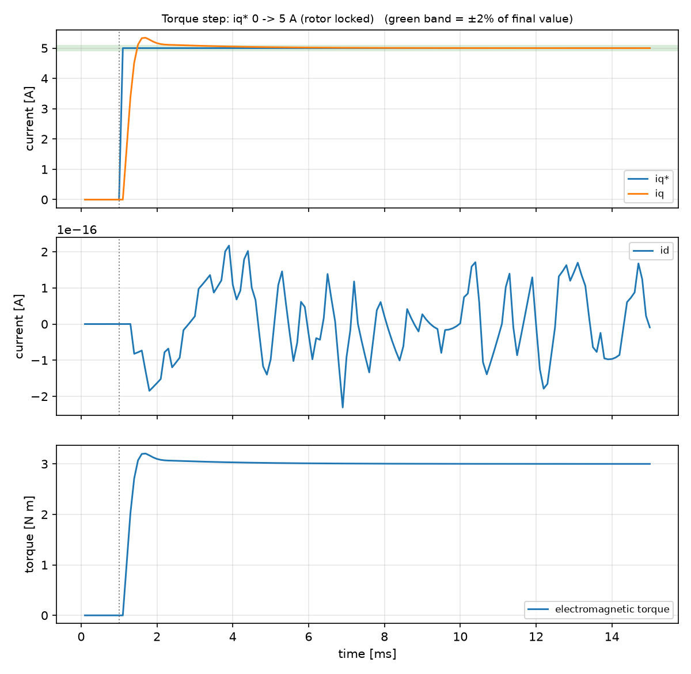
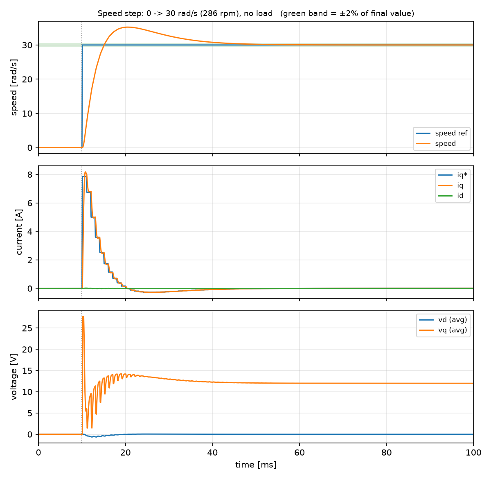
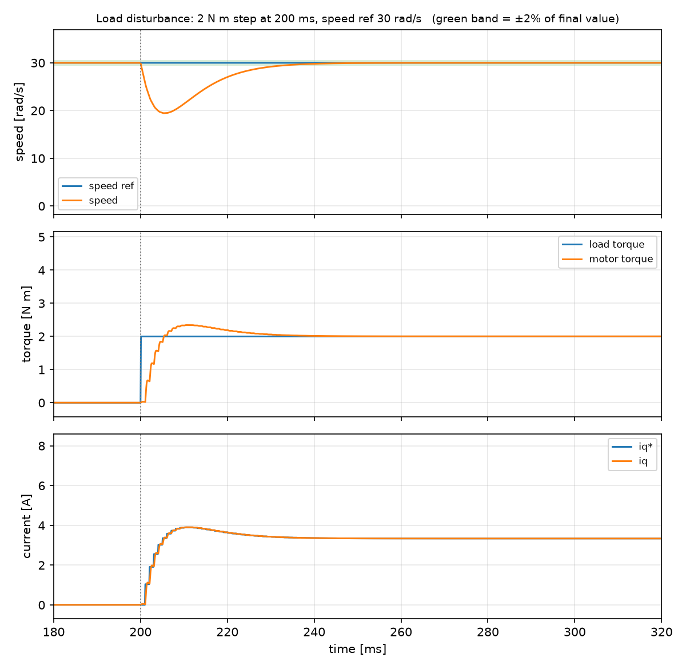
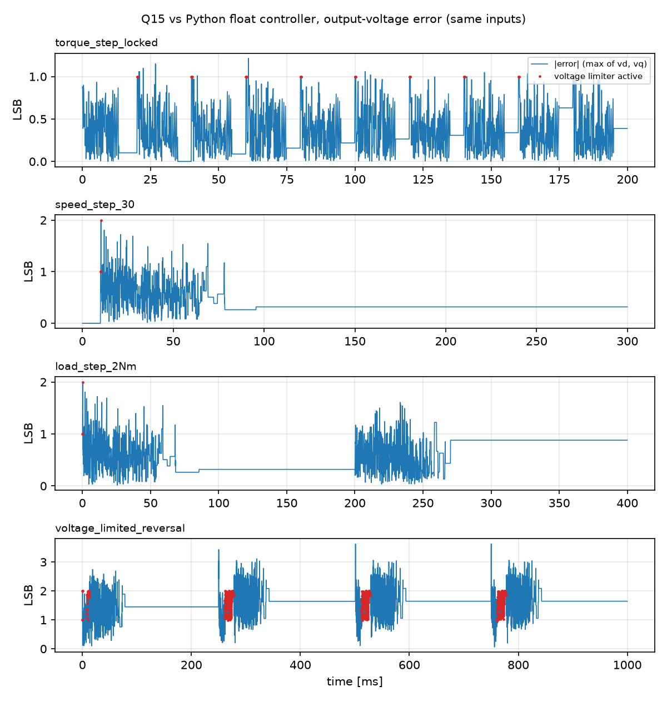
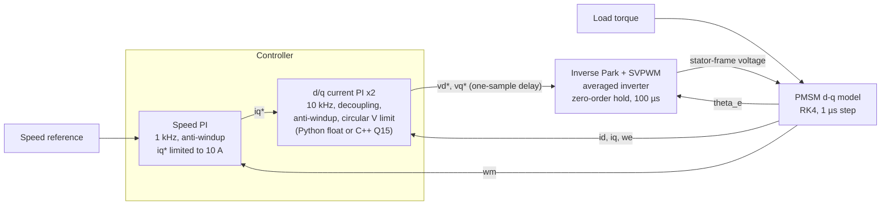
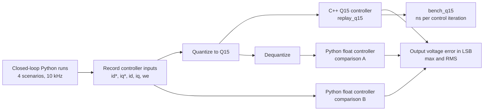

# PMSM Field-Oriented Control: Python simulation and Q15 fixed-point C++ port

A simulation of a field-oriented-controlled permanent-magnet synchronous motor (PMSM) drive, built the way a servo-drive or inverter controller is structured:

- **Python**: d-q motor model (RK4, 1 µs step), Clarke/Park transforms, SVPWM at 10 kHz with an averaged inverter, PI current loops (10 kHz) with decoupling and anti-windup, and a 1 kHz speed loop. All gains come from pole placement.
- **C++17**: a saturating **Q15 fixed-point** port of the current-loop controller with documented scaling, built with CMake.
- **Verification**: the same recorded closed-loop input vectors are replayed through the Python float controller and the C++ Q15 controller, and the output error and the cost of one control iteration are reported.

Everything here is **simulation only**. There is no hardware validation (see [Assumptions and limitations](#assumptions-and-limitations)).

## Results

Every number in this section is copied from files written by the scripts in this repository (`results/*.json`, `results/*.md`) by `scripts/update_readme.py`, together with the commit, machine and compiler it was produced on. Nothing is typed by hand.

### Closed-loop experiments

<!-- BEGIN:experiments -->
| Experiment | Signal | Rise 10-90 % [ms] | Overshoot [%] | Settling 2 % [ms] | Steady-state error |
|---|---|---|---|---|---|
| Torque step (5 A, locked rotor) | iq | 0.27 | 6.8 | 1.60 | -0.0003 A |
| Speed step (30 rad/s) | speed | 3.5 | 17.4 | 32.1 | -0.0000 rad/s |
| Load step (2 N m) | speed | n/a | dip 10.54 rad/s (35.1 %) | recovery 32.3 | 0.0000 rad/s |

_Generated by `scripts/run_experiments.py` (commit `054cf4d`, Python 3.11.18, arm64, run time 1.19 s). Full data: `results/metrics.json`._
<!-- END:experiments -->

| Torque step (current loop, rotor locked) | Speed step | Load disturbance |
|---|---|---|
|  |  |  |

Metric definitions: rise time is 10 % to 90 % of the step (interpolated between 100 µs samples), overshoot is relative to the step size, settling time uses a ±2 % band, and steady-state error is the mean over the last 5 % of the record. For the load disturbance, "dip" is the largest speed deviation after the load step and "recovery" is the time until speed stays inside ±2 % of the reference.

### Q15 port vs Python float controller

<!-- BEGIN:verification -->
| Scenario | Steps | Limiter active | Max err [LSB] | RMS err [LSB] | Linear-only max [LSB] | Linear-only RMS [LSB] |
|---|---|---|---|---|---|---|
| torque_step_locked | 2000 | 1.8 % | 1.21 | 0.30 | 1.21 | 0.29 |
| speed_step_30 | 3000 | 0.1 % | 2.00 | 0.35 | 1.81 | 0.35 |
| load_step_2Nm | 4000 | 0.1 % | 2.00 | 0.50 | 1.81 | 0.50 |
| voltage_limited_reversal | 10000 | 5.5 % | 3.63 | 1.18 | 3.63 | 1.17 |
| **all** | 19000 | 3.1 % | 3.63 | 0.90 | 3.63 | 0.89 |

Limited steps only: max 2.00 LSB, RMS 1.21 LSB. End-to-end (comparison B, all steps): max 9.28 LSB, RMS 2.46 LSB.
1 LSB = 0.846 mV. Time per control iteration: min 20.7 / median 21.3 / max 28.4 ns (Apple M4, Apple clang version 17.0.0 (clang-1700.0.13.5), -std=c++17 -O2 -Wall -Wextra).

_Generated by `scripts/verify_q15.py` (commit `054cf4d`, Apple M4, Apple clang version 17.0.0 (clang-1700.0.13.5), `-std=c++17 -O2 -Wall -Wextra`, Python 3.11.18). Full data: `results/verification.json`._
<!-- END:verification -->



How to read it: errors are differences in the controller's output voltage, in Q15 LSBs (1 LSB = V_base / 32768, where V_base = Vdc/√3 is the linear SVPWM limit). The table compares the C++ Q15 controller with the Python float controller fed the *same numbers* (so only the controller's own quantization and rounding show up). The end-to-end figure also includes quantizing the five input signals to Q15. Steps where the voltage limiter is active are reported separately, because near the limit the circular clamp is very steep and a 1 LSB difference in `vd` can move the `vq` limit by tens of LSBs.

## Architecture



Timing per 100 µs PWM period: sample currents, speed and angle, run the controllers, and apply the new voltage command in the *next* period (one sample of computation delay, 1.5 · Ts in total with the zero-order hold). The plant integrates 100 RK4 steps of 1 µs per period and re-projects the held stator-frame voltage with the rotating rotor angle at each step.

## Controller design

Both loops are first-order plants under PI control, so the closed-loop characteristic polynomial is `s² + (a + b·Kp)·s + b·Ki`. Matching it to `s² + 2ζωn·s + ωn²` gives `Kp = (2ζωn − a)/b` and `Ki = ωn²/b`.

| Loop | Plant | a | b | Bandwidth | ζ | Kp | Ki |
|---|---|---|---|---|---|---|---|
| d and q current | `L·di/dt = u − R·i` (after decoupling) | R/L | 1/L | 200 Hz | 1.5 | 2ζωn·L − R ≈ 4.78 V/A | ωn²·L ≈ 2211 V/(A·s) |
| Speed | `J·dω/dt = Kt·iq − B·ω − T_L` | B/J | Kt/J | 25 Hz | 1.0 | (2ζωn·J − B)/Kt ≈ 0.262 A/(rad/s) | ωn²·J/Kt ≈ 20.6 A/rad |

- Decoupling feed-forward: `vd = u_d − we·Lq·iq`, `vq = u_q + we·(Ld·id + ψf)`.
- Anti-windup: back-calculation with `Tt = Ti`, on a circular voltage limit `|v| ≤ Vdc/√3` with d-axis priority; the speed loop clamps `iq*` at ±10 A with the same scheme.
- Why 200 Hz and not higher: the continuous-time design ignores the 1.5 · Ts loop delay. `scripts/sweep_current_bw.py` prints step-response overshoot versus bandwidth with the delay simulated; higher bandwidth buys little rise time and costs a lot of overshoot.

## Fixed-point port

`cpp/include/current_controller_q15.hpp` and `cpp/src/current_controller_q15.cpp`. Per-unit scaling (I_base = 20 A, V_base = Vdc/√3, W_base = 400 rad/s), Q15 signals, Q12 and Q15 gains, Q27 integrators in `int32`, `int64` intermediates, round-to-nearest, saturating narrowing, and an integer-only square root for the voltage circle. The full format table, equations and overflow argument are in [`docs/q15_scaling.md`](docs/q15_scaling.md). Gains that do not fit their format throw at start-up instead of wrapping.

The C++ tests (`cpp/tests/test_q15.cpp`) check the saturating primitives, gain quantization, polarity, the voltage circle with d-axis priority, anti-windup in a closed loop, a closed-loop comparison against a double-precision model of the same algorithm, and extreme inputs. They run clean under AddressSanitizer and UndefinedBehaviorSanitizer (`-DFOC_SANITIZE=ON`).

## Verification method



The four scenarios are a locked-rotor torque step, a 30 rad/s speed step, a 2 N·m load step, and a ±60 rad/s speed reversal that drives the controller into voltage saturation. Each controller starts from zero state and sees identical inputs. A test checks that a deliberately wrong float reference (decoupling disabled) fails the comparison by a wide margin, so the comparison cannot pass vacuously.

Timing method: the recorded vectors are cycled in order so the integrator state evolves as in a real run, each rep is a batch of 1M iterations divided by the count (this keeps clock-read overhead out), one warm-up rep is discarded, and the min, median and max over 15 reps are reported. Each iteration depends on the previous one, so this is latency, not throughput.

## Quick start

Requirements: macOS or Linux, Python 3.11, a C++17 compiler (clang++ or g++), and optionally CMake 3.16+.

```bash
git clone https://github.com/mastermind370/pmsm-foc.git && cd pmsm-foc
python3.11 -m venv .venv && source .venv/bin/activate
pip install -r requirements.txt

pytest -v                                       # Python tests, plus C++ vs Python verification
PYTHONPATH=src python scripts/run_experiments.py # experiments -> results/metrics.json + plots
PYTHONPATH=src python scripts/verify_q15.py      # Q15 vs float + timing -> results/verification.json
python scripts/update_readme.py                  # copy those results into this README
```

C++ tests, either with CMake:

```bash
cmake -S cpp -B build/cpp -DCMAKE_BUILD_TYPE=Release
cmake --build build/cpp -j
./build/cpp/test_q15
```

or directly with a compiler:

```bash
clang++ -std=c++17 -O2 -Icpp/include cpp/src/current_controller_q15.cpp cpp/tests/test_q15.cpp -o /tmp/test_q15 && /tmp/test_q15
```

Other scripts: `scripts/demo_svpwm.py` plots SVPWM duty cycles, and `scripts/sweep_current_bw.py` shows the current-loop bandwidth trade-off.

## Repository layout

```
src/pmsm_foc/     params, plant (RK4 d-q model), transforms, svpwm, inverter (averaged, ZOH),
                  control (PI + pole placement + anti-windup), drive (closed loop),
                  metrics, experiments
scripts/          run_experiments.py, verify_q15.py, update_readme.py,
                  demo_svpwm.py, sweep_current_bw.py
tests/            analytic plant tests, transform/SVPWM tests, control tests, metric tests,
                  Q15-vs-float verification, README checks
cpp/              include/ (q15.hpp, current_controller_q15.hpp, default_config.hpp),
                  src/, tests/test_q15.cpp, tools/ (replay_q15, bench_q15), CMakeLists.txt
docs/             q15_scaling.md
results/          generated plots, metrics.json, verification.json
```

## Assumptions and limitations

- **Simulation only.** Nothing has been run on hardware or a target MCU. The timing figure is measured on a desktop-class CPU and does not show that the controller meets a real-time deadline on a motor-control microcontroller.
- **Assumed parameters.** Rs, Ld, Lq, flux linkage, pole pairs and DC bus are the stated design values. The rotor and load inertia (5·10⁻⁴ kg·m²), viscous friction (10⁻⁴ N·m·s/rad) and the 10 A current limit are assumptions chosen for this project, not data from a real motor.
- **Ideal sensing.** Current, speed and angle measurements are ideal: no ADC quantization or offset, no encoder quantization, no noise.
- **Averaged inverter.** Two-level averaged model with dead-time ignored. The zero-order hold and one-sample delay are modeled; switching ripple is not.
- **Linear modulation only.** The voltage limit is the inscribed circle of the hexagon. There is no field weakening, no MTPA, and Ld = Lq (surface-mounted magnets, no saliency).
- **Scope of the port.** Only the current-loop controller is ported to Q15; the speed loop, Park transforms and SVPWM remain in Python.
- **Settling and rise times** are resolved to the 100 µs logging period (rise time is linearly interpolated).

## Possible extensions

Field weakening and MTPA for an interior-magnet motor, dead-time and ADC models, sensorless estimation, porting the speed loop and the transforms to fixed point, and running the C++ controller on an MCU target or in a hardware-in-the-loop setup.
